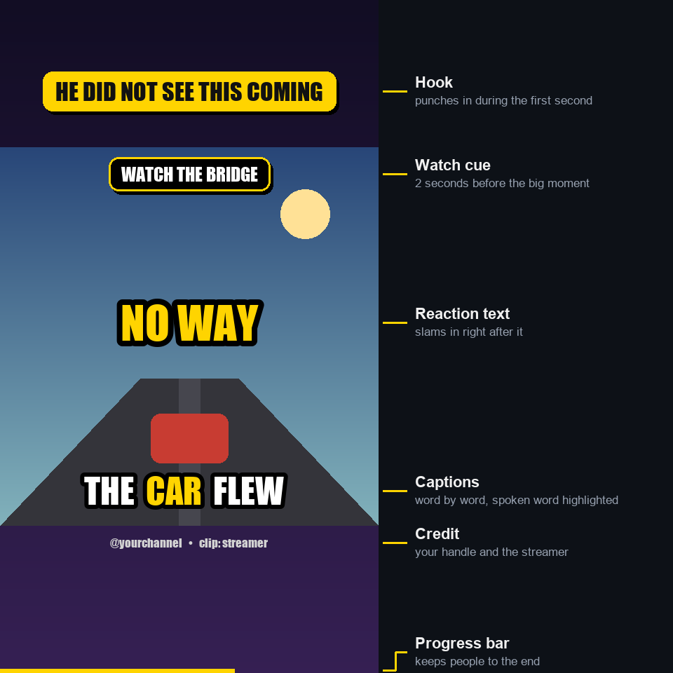
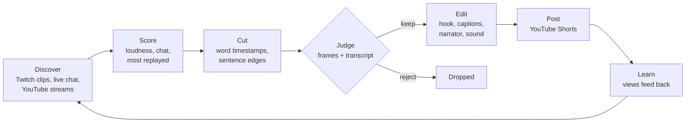

<div align="center">


<h1 align="center">stream-clipper</h1>

<p align="center"><b>Streamers make the moments.<br>This finds them, edits them and posts them while you sleep.</b></p>

<p align="center"><b>The open-source GTA 6 clipper</b> · a Claude Code skill · works with OpenAI Codex · YouTube Shorts automation for any game</p>

<p align="center">A hands-off clip factory for game streams. It watches the biggest streams of a game, catches the moments viewers react to, turns them into vertical Shorts with a hook, animated captions and a narrator, writes titles from real search data, and uploads them to your YouTube channel. Everything runs on your own computer.</p>

<p align="center">


</p>
<p align="center">


<a href="https://github.com/taarruunnnn/stream-clipper/stargazers"></a>
</p>

<p align="center"><sub>Unofficial fan project. Not affiliated with Rockstar Games, Take-Two, Twitch, YouTube or Anthropic.</sub></p>

<p align="center">
<a href="#install-in-5-minutes">Install</a> ·
<a href="#your-first-clip">First clip</a> ·
<a href="#let-it-run-by-itself">Run hands-off</a> ·
<a href="#post-to-youtube">Post to YouTube</a> ·
<a href="#use-it-from-claude-or-chatgpt">Claude / ChatGPT</a> ·
<a href="#using-it-give-it-a-shoutout">Shoutout</a> ·
<a href="#questions-people-ask">FAQ</a> ·
<a href="#contact">Contact</a>
</p>

</div>

```
/plugin marketplace add taarruunnnn/stream-clipper
/plugin install stream-clipper@stream-clipper
```

Two lines in Claude Code, then say: *"Use stream-clipper to set up a clips channel for GTA 6 and show me today's best moments."*

> ⭐ **If this helps you, please star the repo.** It is how other people find it. Bugs, ideas and pull requests are all welcome: see [CONTRIBUTING.md](CONTRIBUTING.md).

---

## What a finished clip looks like

<p align="center"></p>

Every part is there for a reason: the **hook** stops the swipe, the **watch cue** gives a reason to stay, the **reaction text** and a flash make the moment land with the sound off, **captions** carry the clip for people watching muted. A British-voiced narrator sets up the clip in the first seconds and reacts after the payoff, and every piece of text arrives with a sound.

## What it does for you

| | |
|---|---|
| 🔎 **Finds moments** | Today's most-viewed viewer clips on Twitch, live streams (cuts when chat explodes), and finished YouTube streams |
| 🧠 **Picks only good ones** | An AI judge looks at frames and the transcript, scores each clip 1-10 and throws out the dull, the unsafe and the wrong-language ones |
| ✂️ **Edits** | Vertical 1080x1920 with hook, animated word-by-word captions, emojis, zoom on the peak, narrator and sound effects |
| 🏷️ **Writes titles that get found** | Pulls what people are searching on YouTube right now and picks the title by a scoring rule, not by taste |
| 🚀 **Posts** | Straight to your YouTube channel through your own free Google project |
| 📈 **Learns** | Reads view counts back and feeds your best hooks and titles into the next ones |

## Install in 5 minutes

New to the terminal? That's fine. Open the **Terminal** app and paste these one block at a time.

**You need:** a Mac with Apple Silicon (M1 or newer) is the tested setup. Windows and Linux are written but untested, see [Platform support](#platform-support).

**1. Install the basics** (skip any you already have). [Homebrew](https://brew.sh) is the Mac's app installer for the terminal:

```bash
brew install python ffmpeg node
```

**2. Install Claude Code** and sign in. It is the AI that judges clips and writes hooks: [claude.com/claude-code](https://claude.com/claude-code)

**3. Download this project:**

```bash
git clone https://github.com/taarruunnnn/stream-clipper
cd stream-clipper
```

**4. Install its parts:**

```bash
python3 -m venv .venv
source .venv/bin/activate
pip install -r requirements.txt
(cd motion && npm install)
```

**5. Open the dashboard:**

```bash
python -m clipper ui
```

Your browser opens at `http://127.0.0.1:8765`. That page is your control room.

> Every time you come back later, run `cd stream-clipper` and `source .venv/bin/activate` first.

## Your first clip

1. Find who is streaming your game right now:
   ```bash
   python -m clipper streams
   ```
2. Copy a link from that list, or any YouTube or Twitch video link, paste it into the box at the top of the dashboard and click **Find clips**.
3. Wait a minute or two. Clips appear with a hook, title and caption already written. Watch them, edit anything, click **Render**.

Nothing has been posted anywhere. The finished videos are on your computer, and **Show file** opens the folder.

## Let it run by itself

```bash
python -m clipper auto
```

That one command loops forever: discover, judge, edit and (if you allow it) post. To have it start whenever you log in to your Mac:

```bash
python -m clipper autostart on
```

**Two safety catches are on by default**, so nothing surprising happens on day one:

| Setting | Default | What it means |
|---|---|---|
| `mode` | `"approve"` | Clips are prepared, but you press **Post** |
| `privacy` | `"private"` | Uploads are visible only to you |

When you trust it, switch them in `config.local.toml` (see [Make it yours](#make-it-yours)).

> 💤 **It only works while the computer is awake.** The loop keeps a Mac awake while it is plugged in with the lid open (the screen can turn off). Close the lid and it pauses; open it and it carries on where it left off.

## Post to YouTube

This is the fiddliest part, and you only do it once. It is free and allows 100 uploads a day.

1. Go to [console.cloud.google.com](https://console.cloud.google.com), create a project, and enable **YouTube Data API v3**.
2. Open **Google Auth Platform**, choose **External**, and add your own Google account as a **test user**.
3. Under **Clients**, create a client of type **Desktop app** and download its JSON file.
4. Save that file in the `stream-clipper` folder as `client_secret.json`.
5. Connect your channel:
   ```bash
   python -m clipper youtube-login
   ```
   Pick your channel and approve. Google shows an "unverified app" warning because the app is your own; that is expected.

Do one private upload first and watch it on your phone before going public.

## Make it yours

Create a file called `config.local.toml` in the project folder. Anything you put there overrides the defaults in `config.toml`, and it is never uploaded anywhere.

```toml
[brand]
handle = "@yourchannel"          # shown as a small watermark
accent = "#FFD400"               # hook box and highlight colour

[auto]
game = "Grand Theft Auto VI"     # exactly as Twitch names the category
seo_seed = "gta 6"               # the phrase titles are built around
mode = "auto"                    # post without asking
daily_cap = 4                    # posts per day

[youtube]
channel_id = "UC..."             # uploads to any other channel are refused
privacy = "public"
```

Works for any game Twitch has a category for: change `game` and `seo_seed`.

<details>
<summary><b>All commands</b></summary>

```bash
python -m clipper ui                      # the dashboard
python -m clipper streams                 # who is live with the game
python -m clipper radar <twitch-login>    # what viewers are clipping on a channel
python -m clipper find <url>              # best moments of a finished stream or video
python -m clipper live <url> --minutes 120  # cut a clip whenever chat explodes
python -m clipper keywords                # what people search, ranked by views
python -m clipper topics                  # searched moments, and your clips for each
python -m clipper learn                   # view counts and what is working
python -m clipper auto                    # the whole loop
python -m clipper autostart on|off|status # start at login (macOS)
python -m clipper list                    # every clip and its status
```
</details>

<details>
<summary><b>The two edit styles and what they cost</b></summary>

| | Classic | Motion (`motion = true`, the default) |
|---|---|---|
| Text | Still hook box and captions | Animated hook, popping captions, emojis, cue and reaction text |
| Audio | Narrator intro | Narrator intro and reaction, a sound on every text element |
| Time per 20 s clip on an M5 | about 16 s | about 100-160 s |

The loop renders quick previews in the classic style and only uses motion for the clip it is about to post, so six posts a day cost well under an hour of background processing.
</details>

## Use it from Claude or ChatGPT

**Claude Code**: the two `/plugin` lines at the top install a skill. After that, just ask in plain words: *"clip this stream"*, *"what are people searching for GTA 6"*, *"start the clipper"*.

**Claude apps**: zip the `skills/stream-clipper` folder and upload it as a skill.

**ChatGPT**: the browser version cannot run programs on your computer, so it can only guide you. Paste the contents of [`skills/stream-clipper/SKILL.md`](skills/stream-clipper/SKILL.md) into a project or custom GPT as instructions. OpenAI's **Codex** command-line agent can run the project itself; it reads [`AGENTS.md`](AGENTS.md).

## How it works



For a long stream it never downloads the whole video. It scores every second from the audio and metadata alone, downloads only the 40 seconds around each winning moment, and starts the cut on a sentence about 12 seconds before the peak so the build-up is intact.

## Questions people ask

**Will this make me money or get me views?** Nobody can promise that, and this README won't. It gives you speed and consistency. Views depend on the moments, the competition and luck.

**Does it cost anything?** The tool is free. You need a Claude Code subscription for the AI judge. YouTube posting is free.

**Is it allowed to post other people's streams?** Only if the creator allows it. Read [Use it responsibly](#use-it-responsibly) before you post anything.

**Will it slow my computer down?** Barely. Heavy work runs at background priority on the efficiency cores, one job at a time.

**Does it work when my laptop is asleep?** No. A sleeping computer runs nothing. Keep it plugged in with the lid open, or use a desktop.

**Why were most of my clips rejected?** That is normal. The judge keeps roughly one clip in eight to ten. Lower `min_score` in the config if you want more volume and accept weaker clips.

**Why is there a line about stream-clipper in my video descriptions?** It is a small credit that keeps this free project discoverable. One setting turns it off: `tool_credit = false`.

**Can I use my own voice or style?** Yes. Colours, fonts, the narrator voice, sound effects and layout are all settings in `config.toml`.

## Platform support

| | Status |
|---|---|
| macOS on Apple Silicon | Developed and tested here: GPU transcription, hardware video encoding, start at login |
| Linux, Windows, NVIDIA GPUs | The code paths are written (faster-whisper, NVENC or x264, font fallbacks) but **have never been run**. Expect rough edges. Reports and fixes are very welcome |

## Use it responsibly

This tool reposts other people's work. That puts obligations on you, not on the software.

- Clip creators who allow it: a clipping campaign, a stated clip policy, or direct permission. Keep the credit on.
- Adding a hook and captions is editing, not permission. A creator or publisher can still have a clip removed.
- If a creator asks you to take something down, do it and add them to `blocklist`.
- Plain reposts are generally not eligible for platform monetisation. Your own commentary is what changes that.
- Posting unattended means nobody looked at the clip first. The judge filters a lot, not everything.

## Known limits

- Streams longer than 4 hours are skipped on YouTube.
- Live mode on Twitch records what an anonymous viewer sees, including ad-break screens. The judge rejects them, but they waste time.
- Loudness alone is a weak signal; most picks from streams with nothing else get rejected.
- The narrator uses an unofficial free route to Microsoft's online voices and can break without notice.
- There are no automated tests yet.

## Using it? Give it a shoutout

This tool is free and always will be. If it earns you views, the best thank-you is telling other creators where it came from. Three easy ways, pick any:

**1. Leave the credit line on (it is already on).** Every video description ends with one line:

```
Clipped with stream-clipper (free, open source): github.com/taarruunnnn/stream-clipper
```

It costs you nothing and it is how the next creator finds the tool. To remove it, set `tool_credit = false` under `[publish]` in `config.local.toml`. No hard feelings.

**2. Mention it once.** Copy any of these into a video, a community post, or your channel's About page:

> My clips are made with stream-clipper, a free open-source tool that finds and edits the best stream moments automatically: github.com/taarruunnnn/stream-clipper

> How I make these clips: stream-clipper, free on GitHub. Link in the description.

Have a site, a Notion page or your own repo? Use the badge:

```markdown
[](https://github.com/taarruunnnn/stream-clipper)
```

[](https://github.com/taarruunnnn/stream-clipper)

**3. Get your channel featured here.** Shoutouts go both ways: [fill in this short form](https://github.com/taarruunnnn/stream-clipper/issues/new?template=showcase.yml) and your channel is added to the list below, with a link.

### Channels made with stream-clipper

| Channel | Game |
|---|---|
| [Vice Clipped - GTA 6 Clips](https://www.youtube.com/@viceclipped-t5r) | GTA 6 |
| *Yours next: [add your channel](https://github.com/taarruunnnn/stream-clipper/issues/new?template=showcase.yml)* | |

## Contributing

The most useful things right now: run it on Windows or Linux and report what breaks, add tests, add more posting targets. Details in [CONTRIBUTING.md](CONTRIBUTING.md).

## Contact

Questions, ideas, or want to learn how it was built? Email **[tarunkg1999@gmail.com](mailto:tarunkg1999@gmail.com)**, or [open an issue](https://github.com/taarruunnnn/stream-clipper/issues) so others can benefit from the answer.

## License

MIT. See [LICENSE](LICENSE). Built with [Claude Code](https://claude.com/claude-code).
